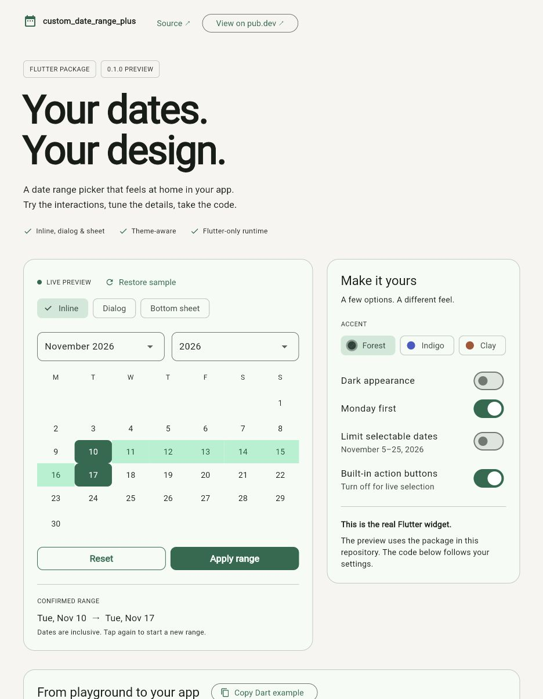

# Custom Date Range Plus

A date range picker you can embed in a Flutter filter panel, form, or bottom sheet—or open as a dialog that returns a `DateTimeRange`.

- Inclusive date limits, same-day ranges, and easy reselection.
- Material theme colors with light and dark theme support.
- Localized dates, locale-aware week starts, and right-to-left layouts.
- Keyboard-accessible controls and full-date screen-reader labels.
- Optional action buttons, live selection callbacks, and custom colors and labels.
- No runtime dependencies beyond Flutter.

## See it in action



The playground runs the actual package, with inline, dialog, and bottom-sheet presentations. Try three accent colors, dark mode, week-start preferences, date limits, and live selection; then copy a Dart example matching your settings.

[Dark appearance](doc/screenshots/playground-dark.png) · [Mobile dialog](doc/screenshots/playground-mobile.png) · [Run or deploy the playground](example/README.md)

## Try it

The repository contains the upcoming **0.1.0** release. The published version is still **0.0.3**; the API below describes this checkout.

```sh
git clone https://github.com/dartpilot0017/custom_date_range_picker.git
cd custom_date_range_picker/example
flutter pub get
flutter run -d chrome
```

The example includes the interactive playground and copyable Dart snippets. To try this checkout in another app:

```yaml
dependencies:
  custom_date_range_plus:
    path: ../custom_date_range_picker
```

After 0.1.0 is published, use `flutter pub add custom_date_range_plus` instead. Requires Flutter 3.27.2 / Dart 3.6.1 or newer.

## Open a dialog

```dart
import 'package:custom_date_range_plus/custom_date_range_plus.dart';
import 'package:flutter/material.dart';

Future<void> chooseDates(BuildContext context) async {
  final range = await showCustomDateRangePicker(
    context: context,
    minDate: DateTime(2024),
    maxDate: DateTime(2030, 12, 31),
    title: 'Filter by date',
    confirmText: 'Apply range',
    resetText: 'Reset',
  );

  if (!context.mounted || range == null) return;
  // Use range.start and range.end to filter your data.
  ScaffoldMessenger.of(context).showSnackBar(
    SnackBar(content: Text('${range.start} – ${range.end}')),
  );
}
```

Confirm returns the range. Dismissal returns `null`. Reset clears the draft and keeps the dialog open.

## Embed a calendar

```dart
DateRangePicker(
  minDate: DateTime(2024),
  maxDate: DateTime(2030, 12, 31),
  startDate: DateTime(2026, 11, 7),
  endDate: DateTime(2026, 11, 14),
  filledButtonText: 'Apply',
  outlinedButtonText: 'Clear',
  onConfirm: (range) {
    debugPrint('${range.start} – ${range.end}');
  },
  onSelectionChanged: (range) {
    // null while incomplete or after reset; a range after the second tap.
  },
)
```

Give the widget a finite width (for example, `Expanded` inside a `Row`). It caps its width at 480 logical pixels and scrolls when its height is constrained. No device-size initialization is required. For a bottom sheet, embed it with padding and close the sheet explicitly from `onConfirm`.

## Selection behavior

1. Tap a date to choose the start.
2. Tap the same or a later date to choose the end. An earlier date replaces the start.
3. Tap another date after completing a range to begin a new range.
4. Confirm becomes enabled only when both dates are selected. Reset always clears both dates.

Dates use their year, month, and day fields; time components are discarded **without converting timezones**. Bounds are inclusive and default to January 1, 1900 and December 31, 2100. Supply explicit bounds for dates outside that window. Initial dates must be ordered and within bounds; an end requires a start. Invalid configurations throw `ArgumentError`.

The picker manages a local draft. Changing `startDate`, `endDate`, `minDate`, or `maxDate` from the parent replaces that draft and updates the visible month. Unrelated parent rebuilds preserve it. To force a reset with unchanged inputs, use a new widget key or the reset button.

| Callback | When it runs |
| --- | --- |
| `onStartDateChanged` | The selected start changes, or reset clears it |
| `onEndDateChanged` | The end changes, including being cleared during reselection |
| `onSelectionChanged` | Every date tap and reset; null for an incomplete range |
| `onDateRangeChanged` | Confirmation with a complete range; reset with null |
| `onConfirm` | Confirmation with a non-null range |
| `onFilledPressed` | After the range callbacks on confirmation |
| `onOutlinePressed` | After reset clears selection and emits callbacks |
| `dropDownOnChanged` | After month/year navigation; observing it does not disable navigation |

Use `showActionButtons: false` with `onSelectionChanged` to build your own action bar. An embedded picker never calls `Navigator.pop`.

## Appearance and localization

Defaults follow `Theme.of(context).colorScheme`. Override `selectedDateColor`, `selectedDateTextColor`, `highlightColor`, `highlightTextColor`, `unselectedDateColor`, `unselectedDateTextColor`, and `weekDayTextStyle` as needed. Button and dropdown styling parameters from 0.0.3 remain available.

Month/date labels and weekday order use `MaterialLocalizations`. Configure your app's `localizationsDelegates` and `supportedLocales` using Flutter's `flutter_localizations` package for non-English locales. `firstDayOfWeek: DateTime.monday` overrides the locale's week start. The reset label defaults to `Reset`; supply `outlinedButtonText` (or the dialog's `resetText`) to translate it.

`dropDownItems`, if provided, must contain exactly 12 unique month labels in January–December order. The year choices and available months follow your date bounds. `dropDownValue` and `dropDownGap` are deprecated; use `startDate` for the initial visible month. Material menus now open in an overlay.

## Migrating from 0.0.3

The old `custom_date_range_picker.dart` import and `DateRangePicker` constructor remain available. Prefer `custom_date_range_plus.dart`, which avoids exporting helper names such as `DropdownButton` that conflict with Flutter Material.

Behavior changes to account for:

- Confirmation no longer automatically pops your route. Use the dialog helper or close your route explicitly in `onConfirm`.
- Incomplete confirmation is disabled instead of throwing a null-check error.
- Date limits are now enforced, including validation of initial selections.
- Reset clears the selection even when `onOutlinePressed` is supplied.
- Default colors now follow your theme. Set explicit colors to retain an older appearance.
- The default week start follows your locale; set `firstDayOfWeek: DateTime.monday` for the former Monday-first layout.
- Default confirmation text is the localized Material OK label; set `filledButtonText: 'Done'` to retain the previous label.
- The accidental globals `size`, `mediaQueryWidth`, and `mediaQueryHeight` have been removed. Use local layout constraints in your application.

## Development

```sh
flutter pub get
dart format lib test example/lib example/test
flutter analyze
flutter test --coverage
cd example
flutter pub get
flutter analyze
flutter test
```

See [CONTRIBUTING.md](CONTRIBUTING.md) for release checks and [CHANGELOG.md](CHANGELOG.md) for changes. Report reproducible bugs through [GitHub issues](https://github.com/dartpilot0017/custom_date_range_picker/issues), including Flutter version, a minimal widget, and expected behavior.

MIT licensed. See [LICENSE](LICENSE).
